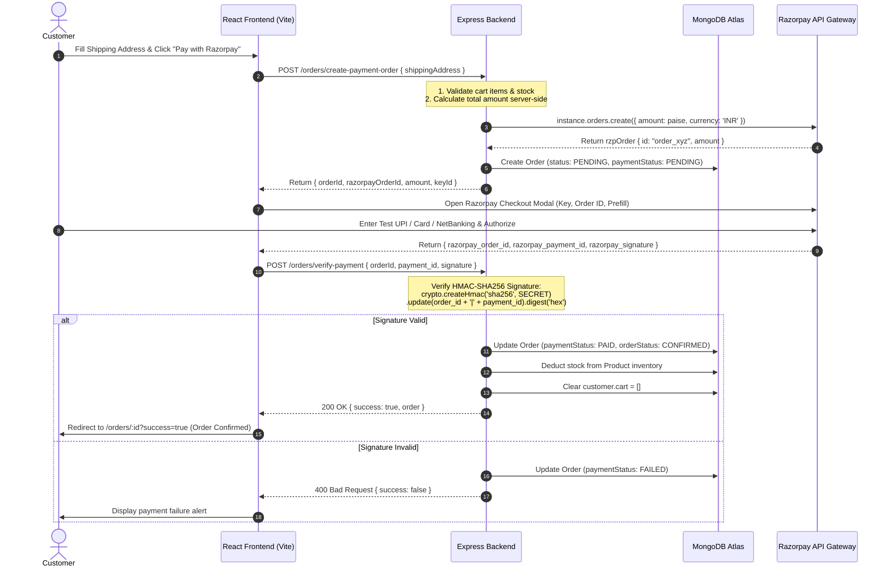

# 🛒 ShopKart — Full-Stack MERN E-Commerce Platform

[](https://nodejs.org/)
[](https://expressjs.com/)
[](https://react.dev/)
[](https://vitejs.dev/)
[](https://tailwindcss.com/)
[](https://www.mongodb.com/)
[](https://razorpay.com/)
[](LICENSE)

> A modern, modular, production-ready full-stack MERN e-commerce web platform featuring custom JWT authentication via secure HttpOnly cookies, dynamic product discovery with multi-parameter search/filters, customer wishlist, persistent shopping cart, and end-to-end Razorpay payment integration with HMAC-SHA256 cryptographic verification.

---

## 📑 Table of Contents

- [📌 Project Overview](#-project-overview)
- [✨ Core Modules & Features (Labs 01 – 06)](#-core-modules--features-labs-01--06)
- [🛠️ Tech Stack](#️-tech-stack)
- [📁 Project Directory Structure](#-project-directory-structure)
- [🚀 Quick Start & Installation](#-quick-start--installation)
- [⚙️ Environment Variables Configuration](#️-environment-variables-configuration)
- [📡 API Reference](#-api-reference)
- [💳 Razorpay Payment Gateway Workflow](#-razorpay-payment-gateway-workflow)
- [🧪 Automated Test Suite](#-automated-test-suite)
- [🛡️ Security Architecture](#️-security-architecture)
- [🤝 Contributing & License](#-contributing--license)

---

## 📌 Project Overview

**ShopKart** was engineered following industry-standard **Model-View-Controller (MVC)** patterns on the backend and a modular **Component-Context** architecture on the frontend. It delivers a seamless, high-performance shopping journey from product discovery to payment confirmation.

### Key Highlights
- **100% Custom Authentication**: Zero reliance on third-party auth wrappers (Firebase, Clerk, Auth0). Built from scratch using native bcrypt and JWT stored in secure `HttpOnly` cookies.
- **Dynamic Catalog Engine**: Fast search with case-insensitive regex, real-time category filtering, and bidirectional price sorting.
- **Persistent State Management**: Customer cart and wishlist are stored directly in MongoDB, persisting across devices and sessions.
- **Tamper-Proof Checkout & Pricing**: Item subtotal, stock levels, and grand total calculations are computed strictly server-side to prevent price manipulation.
- **Full Payment Cycle**: Integrates the official Razorpay Checkout SDK, generates cryptographically signed orders, verifies HMAC-SHA256 signatures, decrements stock in real-time, and clears customer carts post-purchase.

---

## ✨ Core Modules & Features (Labs 01 – 06)

| Module | Lab Focus | Key Capabilities |
|---|---|---|
| **Customer Auth Service** | Lab 01 & 02 | Registration validation, bcrypt hashing (10 salt rounds), JWT signing, HttpOnly + SameSite cookie session management, `/customers/me` profile route, password change, and logout. |
| **Product Discovery & Catalog** | Lab 02 & 03 | Automated database seeding with realistic products, dynamic search bar, category pills (Electronics, Fashion, Books, Home), price sorting (`price_asc`, `price_desc`), stock badges, and detailed product view. |
| **Customer Wishlist** | Lab 04 | Single-click wishlist toggle, populated product references in MongoDB, real-time navbar counter sync, dedicated wishlist management page with instant remove. |
| **Shopping Cart Management** | Lab 05 | Add to cart, quantity increment/decrement with stock limit guards, dynamic subtotal calculation, single-item deletion, and full cart clearing. |
| **Order Processing & Checkout** | Lab 06 | Multi-field delivery address validation, server-side stock verification before payment, pending order creation with immutable product snapshots. |
| **Razorpay Payment Gateway** | Lab 06 | Live Razorpay order creation (`amount` in paise), official Razorpay popup modal, custom interactive test gateway modal with UPI/Card/NetBanking simulation, HMAC-SHA256 signature verification, inventory stock decrementing, and order tracking. |

---

## 🛠️ Tech Stack

### Frontend
- **Framework**: [React 18](https://react.dev/) + [Vite 6](https://vitejs.dev/)
- **Routing**: [React Router DOM v6](https://reactrouter.com/)
- **Styling**: [Tailwind CSS v3](https://tailwindcss.com/) + PostCSS
- **State Management**: React Context API (`CartContext`) + Native Hooks
- **Icons**: [Lucide React](https://lucide.dev/)
- **HTTP Client**: [Axios](https://axios-http.com/) configured with `withCredentials: true`
- **SDK**: Razorpay Checkout.js

### Backend
- **Runtime**: [Node.js](https://nodejs.org/) (v18+)
- **Web Framework**: [Express.js 4](https://expressjs.com/)
- **Database & ODM**: [MongoDB Atlas](https://www.mongodb.com/atlas) with [Mongoose 8](https://mongoosejs.com/)
- **Password Security**: `bcryptjs`
- **Authentication**: `jsonwebtoken` (JWT) + `cookie-parser`
- **CORS**: `cors` with origin reflection & credential support
- **Payment Processing**: Official `razorpay` Node.js SDK + `crypto` (HMAC-SHA256)
- **Automated Testing**: `supertest` + `mongodb-memory-server`

---

## 📁 Project Directory Structure

```text
ShopKart-term05/
├── backend/
│   ├── config/
│   │   └── razorpay.js              # Razorpay instance setup & signature verification
│   ├── controllers/
│   │   ├── customer.controller.js   # Registration, login, profile, logout, password change
│   │   ├── product.controller.js    # Catalog queries, search, category filter, price sort
│   │   ├── wishlist.controller.js   # Wishlist toggle, fetch populated items, item count
│   │   ├── cart.controller.js       # Cart add, update quantity, remove item, clear cart
│   │   └── order.controller.js      # Razorpay order generation, verify payment, get orders
│   ├── middlewares/
│   │   └── auth.middleware.js       # JWT cookie verification & req.user injection
│   ├── models/
│   │   ├── customer.model.js        # Customer schema (with embedded cart & wishlist refs)
│   │   ├── product.model.js         # Product schema with stock and pricing validations
│   │   └── order.model.js           # Order schema with delivery address & item snapshots
│   ├── routes/
│   │   ├── customer.routes.js       # /customers endpoints
│   │   ├── product.routes.js        # /products endpoints
│   │   ├── wishlist.routes.js       # /wishlist endpoints
│   │   ├── cart.routes.js           # /cart endpoints
│   │   └── order.routes.js          # /orders endpoints
│   ├── scripts/
│   │   └── seedProducts.js          # Initial catalog seed data loader
│   ├── test/
│   │   ├── customer.test.js         # Automated authentication tests
│   │   ├── product.test.js          # Automated product catalog tests
│   │   ├── wishlist.test.js         # Automated wishlist tests
│   │   ├── cart.test.js             # Automated cart tests
│   │   └── order.test.js            # Automated checkout & Razorpay tests
│   ├── utils/
│   │   └── generateToken.js         # JWT signing with HttpOnly cookie assignment
│   ├── .env                         # Server environment configuration
│   ├── index.js                     # Express app setup, DB connection, & route mounting
│   └── package.json                 # Backend dependencies & npm test scripts
│
├── frontend/
│   ├── src/
│   │   ├── components/
│   │   │   ├── Navbar.jsx           # Global sticky navigation with live badge counts
│   │   │   ├── Logo.jsx             # ShopKart responsive brand badge
│   │   │   ├── ProductCard.jsx      # Catalog item card with Wishlist & Cart actions
│   │   │   ├── WishlistCard.jsx     # Wishlist product card with instant removal
│   │   │   ├── CartItem.jsx         # Cart row with [-] Qty [+] controls & stock limits
│   │   │   └── SearchBar.jsx        # Search input, category dropdown, price sorter
│   │   ├── context/
│   │   │   └── CartContext.jsx      # Global cart state, item counts, & subtotal calculations
│   │   ├── pages/
│   │   │   ├── Home.jsx             # Authenticated user dashboard & profile overview
│   │   │   ├── Products.jsx         # Product catalog page
│   │   │   ├── ProductDetails.jsx   # Dedicated product details view
│   │   │   ├── Wishlist.jsx         # Customer wishlist page
│   │   │   ├── Cart.jsx             # Shopping cart review & subtotal summary
│   │   │   ├── Checkout.jsx         # Shipping address form & Razorpay payment trigger
│   │   │   ├── Orders.jsx           # Order history listing with status badges
│   │   │   ├── OrderDetails.jsx     # Single order receipt & delivery stepper
│   │   │   ├── Login.jsx            # Customer sign-in with query redirect support
│   │   │   └── Register.jsx         # Customer account creation
│   │   ├── services/
│   │   │   └── api.js               # Centralized Axios API client (withCredentials: true)
│   │   ├── App.jsx                  # Main routing configuration
│   │   ├── main.jsx                 # React root render
│   │   └── index.css                # Tailwind CSS root stylesheet
│   ├── .env                         # Frontend environment variables
│   ├── index.html                   # HTML template with Razorpay Checkout SDK
│   ├── vite.config.js               # Vite config with smart proxy & HTML bypass
│   ├── tailwind.config.js           # Tailwind theme settings
│   └── package.json                 # Frontend dependencies
│
└── README.md                        # Master repository documentation
```

---

## 🚀 Quick Start & Installation

### Prerequisites
- [Node.js](https://nodejs.org/) (v18 or higher)
- [MongoDB](https://www.mongodb.com/) (Local instance or MongoDB Atlas cluster URI)
- [Razorpay Test Account](https://dashboard.razorpay.com/) *(Optional: Test keys are pre-configured)*

---

### Step 1: Clone the Repository
```bash
git clone https://github.com/<your-username>/ShopKart-term05.git
cd ShopKart-term05
```

---

### Step 2: Backend Setup
```bash
cd backend
npm install
```

Configure your environment variables in `backend/.env`:
```env
PORT=5001
MONGO_URI=mongodb+srv://<username>:<password>@cluster0.vhgf9sz.mongodb.net/shopkart?appName=Cluster0
JWT_SECRET=shopkart_jwt_secret_key_2026_super_secure_lab01
NODE_ENV=development

# Razorpay Test Credentials (or use your own test keys from dashboard.razorpay.com)
RAZORPAY_KEY_ID=rzp_test_TkQfS3DEVkqBxw
RAZORPAY_KEY_SECRET=MRbh8un91R2oHPmoy5ZUTpKb
```

Start the backend service:
```bash
# Production start:
npm start

# Or development watch mode:
npm run dev
```
> The backend server will start on **`http://localhost:5001`** and automatically seed the product catalog into MongoDB if empty.

---

### Step 3: Frontend Setup
In a new terminal window:
```bash
cd ../frontend
npm install
```

Verify `frontend/.env`:
```env
# Leave empty in development to route through Vite's same-origin proxy (http://localhost:5173 -> http://localhost:5001)
VITE_API_URL=
```

Start the Vite development server:
```bash
npm run dev
```
> Open your browser at **`http://localhost:5173`**.

---

## ⚙️ Environment Variables Configuration

### Backend (`backend/.env`)
| Variable | Description | Default / Example |
|---|---|---|
| `PORT` | Port number the Express API server listens on | `5001` *(Avoids macOS port 5000 AirPlay collision)* |
| `MONGO_URI` | MongoDB connection string (Atlas or local) | `mongodb+srv://...` |
| `JWT_SECRET` | Secret key used to sign and verify JWT auth tokens | `shopkart_jwt_secret_key_...` |
| `NODE_ENV` | Environment mode (`development`, `production`, `test`) | `development` |
| `RAZORPAY_KEY_ID` | Razorpay Merchant Key ID | `rzp_test_...` |
| `RAZORPAY_KEY_SECRET` | Razorpay Merchant Secret Key | `MRbh8un9...` |

### Frontend (`frontend/.env`)
| Variable | Description | Default / Example |
|---|---|---|
| `VITE_API_URL` | Base API URL. In development, leave blank to use Vite same-origin proxy | `""` |

---

## 📡 API Reference

### 🔐 Customer Authentication (`/customers`)
| Method | Endpoint | Access | Description |
|---|---|---|---|
| `POST` | `/customers/register` | Public | Register a new customer (`fullName`, `email`, `password`, `phone`) |
| `POST` | `/customers/login` | Public | Authenticate customer & set secure `token` HttpOnly cookie |
| `GET` | `/customers/me` | Protected | Retrieve authenticated customer profile, wishlist, and cart |
| `PATCH` | `/customers/change-password` | Protected | Update account password (`oldPassword`, `newPassword`) |
| `POST` | `/customers/logout` | Protected | Clear `token` cookie and invalidate browser session |

### 📦 Products Catalog (`/products`)
| Method | Endpoint | Access | Description |
|---|---|---|---|
| `GET` | `/products` | Public | Retrieve catalog with optional query filters: `?search=...&category=...&sort=price_asc\|price_desc` |
| `GET` | `/products/:id` | Public | Get single product by MongoDB ObjectId |
| `POST` | `/products` | Public / Admin | Create a new product item |

### ❤️ Customer Wishlist (`/wishlist`)
| Method | Endpoint | Access | Description |
|---|---|---|---|
| `GET` | `/wishlist` | Protected | Fetch authenticated user's wishlist with populated product data |
| `POST` | `/wishlist/:productId` | Protected | Add a product reference to the customer's wishlist |
| `DELETE` | `/wishlist/:productId` | Protected | Remove a product reference from wishlist |
| `PATCH` | `/wishlist/:productId/toggle` | Protected | Toggle wishlist state (adds if absent, removes if present) |
| `GET` | `/wishlist/count` | Protected | Get total number of saved wishlist items |

### 🛒 Shopping Cart (`/cart`)
| Method | Endpoint | Access | Description |
|---|---|---|---|
| `GET` | `/cart` | Protected | Get populated cart with live stock and pricing |
| `POST` | `/cart/:productId` | Protected | Add product to cart (or increment quantity if already present) |
| `PATCH` | `/cart/:productId` | Protected | Update item quantity with stock limit check (`{ quantity: Number }`) |
| `DELETE` | `/cart/:productId` | Protected | Remove specific product line item from cart |
| `DELETE` | `/cart` | Protected | Clear all items from customer's cart |

### 💳 Checkout & Orders (`/orders`)
| Method | Endpoint | Access | Description |
|---|---|---|---|
| `POST` | `/orders/create-payment-order` | Protected | Validate cart, verify stock, create pending Order & Razorpay order (`amount` in paise) |
| `POST` | `/orders/verify-payment` | Protected | Verify Razorpay HMAC-SHA256 signature, mark order `PAID`, decrement stock, & clear cart |
| `GET` | `/orders` | Protected | Retrieve all historical orders for authenticated customer |
| `GET` | `/orders/:id` | Protected | Retrieve full order details and purchased item snapshots |
| `PATCH` | `/orders/:id/status` | Protected | Update order tracking status (`PLACED` → `CONFIRMED` → `SHIPPED` → `DELIVERED`) |

---

## 💳 Razorpay Payment Gateway Workflow



---

## 🧪 Automated Test Suite

The backend includes a comprehensive, automated test suite that verifies schema validations, business logic, authorization policies, and edge cases using **Supertest** and an isolated **in-memory MongoDB database**:

```bash
cd backend

# Run the customer authentication test suite (Lab 01):
npm test

# Run product catalog search, filter, and sort tests (Lab 02/03):
npm run test:products

# Run customer wishlist tests (Lab 04):
npm run test:wishlist

# Run shopping cart and stock calculation tests (Lab 05):
npm run test:cart

# Run checkout, Razorpay order, signature verification & history tests (Lab 06):
npm run test:orders

# Run the entire test suite across all modules:
npm run test:all
```

Evaluator Postman collections are also provided in the `backend/` directory:
- `ShopKart_Customer_Auth.postman_collection.json`
- `ShopKart_Wishlist_Lab04.postman_collection.json`
- `ShopKart_Cart_Lab05.postman_collection.json`
- `ShopKart_Checkout_Orders_Lab06.postman_collection.json`

---

## 🛡️ Security Architecture

1. **HttpOnly Cookie Token Storage**:
   JWT tokens are stored inside `HttpOnly` cookies, preventing malicious client-side JavaScript from accessing session credentials (mitigating XSS attack vectors).
2. **SameSite Lax / Strict Cookies**:
   Protects against Cross-Site Request Forgery (CSRF) while ensuring seamless cross-port communication during development.
3. **Password Security**:
   Passwords are never stored in plaintext. They are salted and hashed using `bcryptjs` with 10 salt rounds. Schemas exclude password fields by default on JSON serialization.
4. **Server-Side Pricing & Inventory Integrity**:
   Cart prices submitted by the client are never trusted. All subtotals, item availability, and Razorpay paise amounts are strictly queried and calculated from the database.
5. **Cryptographic HMAC-SHA256 Payment Verification**:
   Payments are verified using secret-derived cryptographic hashes. Even if network traffic is intercepted, payment states cannot be spoofed without the Razorpay secret key.
6. **Strict Resource Isolation**:
   Users can only access, modify, or view their own carts, wishlists, and orders. Attempts to inspect another customer's order ID returns `404 Not Found`.

---

## 🤝 Contributing & License

Contributions, issues, and feature requests are welcome!

Distributed under the **ISC License**. See `LICENSE` for more information.

---

<p align="center">
  Crafted with ❤️ for the <b>ShopKart Full-Stack MERN Engineering Lab</b>
</p>
